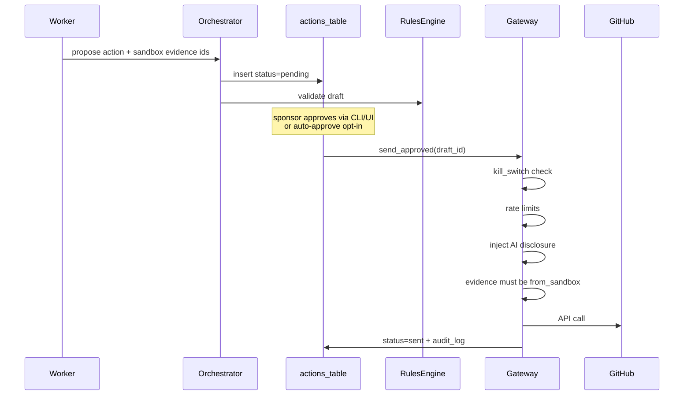
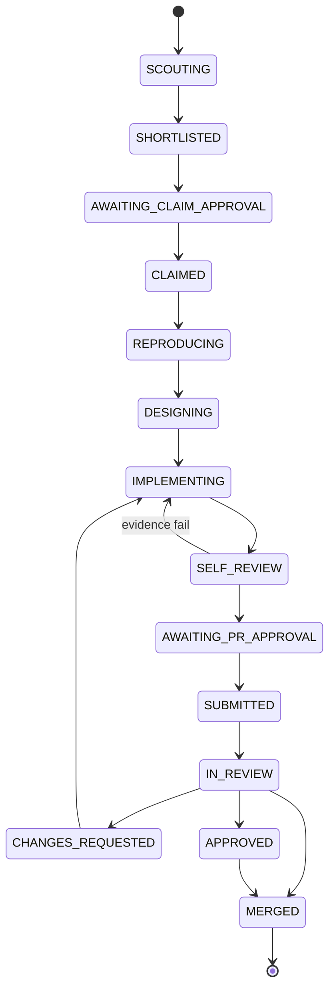

# Architecture

Derived from [PRD_AND_DESIGN.md](PRD_AND_DESIGN.md). Implementation code lives under `src/oss_agent/`. Interfaces are `typing.Protocol` in `protocols.py`.

## Module map

| Module | Responsibility | Credentials |
| --- | --- | --- |
| `config` | Single pydantic `AppConfig` | none |
| `db` | SQLAlchemy models + Alembic migrations | none |
| `workflow` | n8n-inspired workflow engine (graph, IF/wait, item bags) | none |
| `research` | Khoj + last30days-inspired project research before every action | none |
| `factory` | SuperPlane-inspired Factory, lines, work orders, board lanes | none |
| `analysis` | Paperclip-inspired pre-contribution analysis (goal/budget/governance) | none |
| `quality` | Strix-inspired diff quality/security gate (SARIF) | none |
| `orchestrator` | Durable state machine, timeouts, resume | none |
| `scout` | Rules ingestion, project memory, issue scoring | none |
| `rules` | AI policy, PR completeness, rate-limit checks | none |
| `sandbox` | OpenSandbox-inspired sessions + vault; `SandboxRunner` (opensandbox/podman/fake) | never receives secrets; vault handles only |
| `models` | `ModelProvider` (stub / OpenAI-compatible) | model keys via env to worker only |
| `github_read` | Read-only GitHub client | read token optional; no write |
| `gateway` | **Only** writer; drafts → approve → send | GitHub App private key / install token |
| `audit` | Append-only audit log (DB + JSONL files) | none |
| `cli` / `web` | Approval queue, kill switch, status | none |
| `eval` | Offline fixture replay harness | none |

## Credential boundary (invariant 1)

```
[workers / scout / sandbox / orchestrator / cli]
        |  OutwardActionDraft only
        v
   [gateway]  <-- reads secrets from env or root-owned file
        |
        v
   GitHub API (write)
```

Static test: no module outside `oss_agent.gateway` may import `oss_agent.gateway.credentials` (or equivalent).

## Outward action path (invariants 2–4, 8–10)



Default `PolicyConfig.AutoApprove`: all false. Auto-approve is per-action-type opt-in.

## State machine

States and forward edges are defined in `oss_agent.orchestrator.states`.



- Any non-terminal → `ABANDONED` (timeout, policy change, rejection).
- Any non-terminal → `PAUSED` (kill switch). Resume restores `prior_state`.
- LLM never flips state directly; it returns a proposed next action; `TransitionTable.assert_transition` validates.

### Per-state summary

| State | Entry | Exit | Timeout key | Allowed tools |
| --- | --- | --- | --- | --- |
| SCOUTING | project `ai_allowed` | shortlist persisted | `timeouts.SCOUTING` | read GH + memory |
| SHORTLISTED | scores exist | sponsor picks issue | `SHORTLISTED` | none |
| AWAITING_CLAIM_APPROVAL | claim draft | approved/rejected | `AWAITING_CLAIM_APPROVAL` | none |
| CLAIMED | claim sent | start repro | `CLAIMED` | get issue |
| REPRODUCING | clone ready | failing repro artifact | `REPRODUCING` | sandbox + memory |
| DESIGNING | repro ok | design note | `DESIGNING` | memory + read |
| IMPLEMENTING | design ok | sandbox patch | `IMPLEMENTING` | sandbox |
| SELF_REVIEW | patch exists | lint/test evidence | `SELF_REVIEW` | sandbox |
| AWAITING_PR_APPROVAL | evidence pass | PR approved | `AWAITING_PR_APPROVAL` | none |
| SUBMITTED | PR sent | enter review | `SUBMITTED` | get PR |
| IN_REVIEW | remote PR | classify CI/comments | `IN_REVIEW` | GH read + sandbox |
| CHANGES_REQUESTED | need code change | back to implement | `CHANGES_REQUESTED` | sandbox + GH read |
| APPROVED | maintainer approve | merged | `APPROVED` | none |
| MERGED / ABANDONED | terminal | — | 0 | none |
| PAUSED | kill switch | resume prior | 0 | none |

Crash resume: tasks and drafts are durable in SQLite. On startup the orchestrator loads non-terminal tasks and continues from `state` (or `prior_state` if paused).

## Data model

Tables: `projects`, `issues`, `tasks`, `artifacts`, `actions`, `review_items`, `flakes`, `audit_log`, `rate_counters`.

Migration: `migrations/versions/0001_initial_schema.py`.

`artifacts.from_sandbox` must be true for any evidence attached to a PR/comment draft (invariant 8).

## Config schema

`AppConfig` (`OSS_AGENT_` env prefix): `database_url`, `state_dir`, `audit_dir`, localhost `host`/`port`, nested `policy`, `sandbox`, `models`, `timeouts`, `github_credentials_file`.

## Sandbox

`SandboxRunner` Protocol. `PodmanSandboxRunner` (M1): rootless, non-root user, dropped caps, read-only rootfs + writable work volume, resource limits, default-deny network via allowlist proxy, ephemeral, log export. `FakeSandboxRunner` for unit tests. Future: `KvmSandboxRunner`.

## Model providers

`ModelProvider` Protocol. `StubModelProvider` for tests/demo. `OpenAICompatibleProvider` for runtime. Prompts in `prompts/` with untrusted blocks:

```
<<<UNTRUSTED_REPO_CONTENT source="issue:123">>
...
<<<END_UNTRUSTED_REPO_CONTENT>>>
```

## Eval

Offline harness under `oss_agent.eval` replays fixtures in `fixtures/`. Metrics: shortlist precision, reproduction success, draft quality. Report → `docs/EVAL_REPORT.md`.

## Deployment

systemd units in `deploy/systemd/`: `oss-agent-orchestrator.service`, `oss-agent-gateway.service`, `oss-agent-ui.service`. UI binds `127.0.0.1` only.
